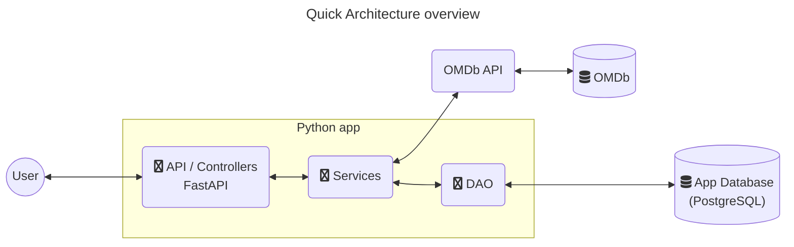

# Architecture 

# Architecture

- **Controllers** (`backend/src/Controller`): the routes of the API. They read the requests, check the JWT token and the role, and call the services.
- **Services** (`backend/src/Service`): the business rules (prices, seats left, screening overlaps, accounting).
- **DAO** (`backend/src/DAO`): the SQL queries to the PostgreSQL database.
- **Model** (`backend/src/Model`): the classes used by all the layers (Movie, Screening, Booking...).
- **OMDb API**: used by `OmdbClient` to search and import movies.