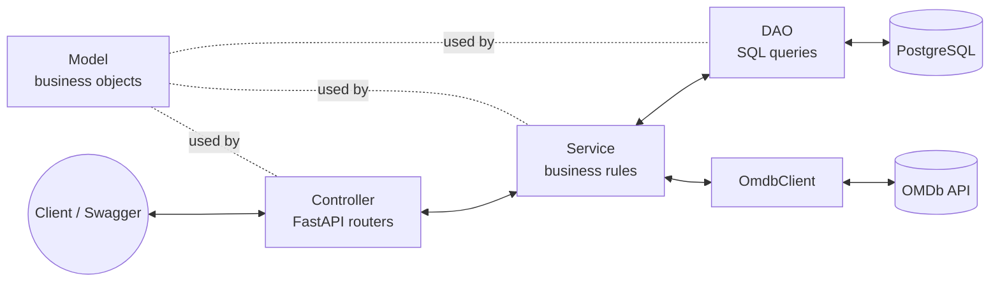

# Developer Guide

This document is for people who want to **continue developing** the application.

---

## 1. Layered architecture

The code follows a classic **layered architecture**. Each layer only talks to the layer directly below it.



| Layer | Folder | Responsibility | Must NOT |
|---|---|---|---|
| **Controller** | `src/Controller/` | Declare HTTP routes, validate input with Pydantic models, check authentication/role, translate exceptions into HTTP status codes | contain business rules or SQL |
| **Service** | `src/Service/` | Business logic: overlap and capacity checks, price computation, accounting aggregates, password hashing, JWT | know about HTTP or write SQL |
| **DAO** | `src/DAO/` | All SQL. One DAO per table / aggregate. `DBConnector` opens connections from the `POSTGRES_*` variables | contain business decisions |
| **Model** | `src/Model/` | Plain business objects (`Movie`, `Screening`, `Booking`, `Ticket`, `AccountingReport`…) shared by all layers | depend on any other layer |

### Main modules

| Feature | Controller | Service | DAO |
|---|---|---|---|
| Users & auth | `UserController`, `JWTBearer` | `UserService`, `PasswordService`, `JWTService` | `UserDAO` |
| Movies (+ OMDb import) | `MovieController` | `MovieService`, `OmdbClient` | `MovieDAO` |
| Rooms | `RoomController` | `RoomService` | `RoomDAO` |
| Screenings | `ScreeningController` | `ScreeningService` | `ScreeningDAO` |
| Bookings | `BookingController` | `BookingService` | `BookingDAO` |
| Tariffs & price revisions | `TariffController`, `PriceRevisionController` | `TariffService`, `PriceRevisionService` | `TariffDAO`, `PriceRevisionDAO` |
| Accounting | `AccountingReportController` | `AccountingReportService` | `AccountingReportDAO` |
---


## 2. Development tools

### Tests: pytest

```
backend/tests/
├── conftest.py     # sets fake JWT_SECRET / OMDB_API_KEY so modules can be imported
├── Model/          # pure unit tests on business objects
├── DAO/            # DB layer, psycopg2 is mocked
├── Service/        # business rules, DAOs and OMDb are mocked
└── Controller/     # HTTP layer with FastAPI TestClient, services are mocked
```

```bash
pdm run pytest                                   # run the whole suite (paths come from pyproject.toml)
pdm run pytest backend/tests/Service -v          # one layer
pdm run pytest -k accounting                     # by keyword
pdm run pytest --cov=backend/src --cov-report=term-missing   # coverage
```

### Code quality

| Command | Tool | What it does |
|---|---|---|
| `pdm format` | Ruff | Formats the code (line length 120) |
| `pdm lint` | Ruff | Lists lint errors (pyflakes, bugbear, import order, complexity…) |
| `pdm typecheck` | Pyrefly | Static type checking. Please type-annotate new functions |


## 3. Adding a feature: checklist

Example: adding customer reviews (optional feature FO1).

1. **Database:** add the table to `database/schema.sql` (and demo rows to `seed.sql`).
2. **Model:** `src/Model/Review.py`.
3. **DAO:** `src/DAO/ReviewDAO.py` with `create`, `find_by_movie`, … plus `tests/DAO/test_review_dao.py`.
4. **Service:** `src/Service/ReviewService.py` (e.g. "a customer can only review a movie they booked") plus tests.
5. **Controller:** `src/Controller/ReviewController.py` with an `APIRouter(prefix="/reviews")`, then `app.include_router(...)` in `API.py`, plus tests.
6. Run format, lint and tests, then open a pull request.

---
